# Modelling, Simulation and Control of a 2R Planar Robotic Arm

**A complete model-to-controller study of a two-link robot arm in Python: analytical kinematics, Lagrangian dynamics, quintic trajectories, PID and computed-torque control, numerical simulation, animation and a model-mismatch robustness study.**

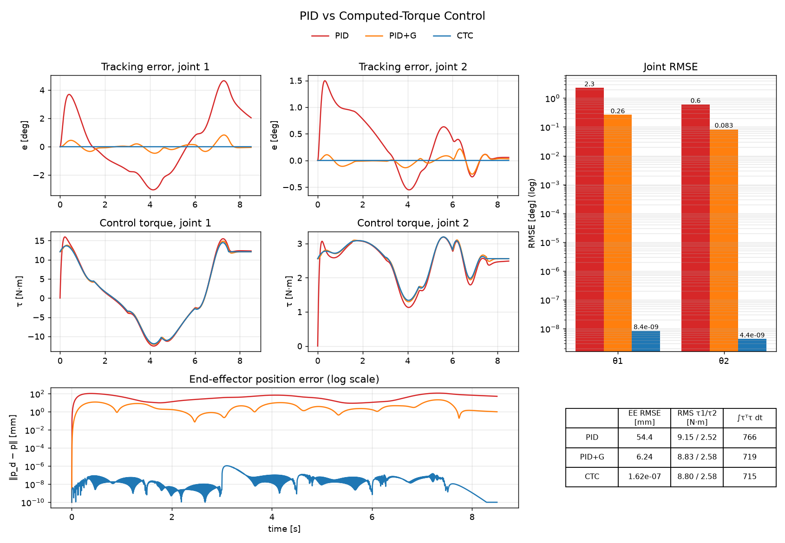

| | |
|---|---|
| **Type** | Independent project · robot dynamics and control |
| **Author** | Mehdi Hasan, Mechanical Engineering, Islamic University of Technology (IUT) |
| **Year** | 2026 |
| **Tools** | Python 3.12 · NumPy · SciPy (`solve_ivp`, RK45) · SymPy · Matplotlib · pytest |
| **Robot** | l₁ = 1.0 m, l₂ = 0.8 m, m₁ = 1.0 kg, m₂ = 0.8 kg, slender rods (I = ml²/12), COM at mid-link, g = 9.81 m/s² |
| **Verification** | **24/24 automated tests pass**: SymPy re-derivation of the dynamics, energy conservation, skew-symmetry of Ṁ − 2C, finite-difference Jacobians, analytic CTC error decay |

### Key results

| Result | Value |
|---|---|
| Energy drift in a 5 s passive swing (model check) | 6.0 × 10⁻⁹ J (relative 2.7 × 10⁻¹⁰) |
| SymPy vs hand-derived M, C, G (200 random states) | max difference 4 × 10⁻¹⁵ |
| End-effector RMSE: PID → PID + gravity compensation → computed torque | **54.4 mm → 6.24 mm → 1.6 × 10⁻⁷ mm** |
| Control effort, PID vs CTC | 766 vs 715 (CTC uses 7 % less) |
| Unmodelled 0.5 kg payload: CTC (PD outer loop) vs CTC + integral | **152 mm vs 10.8 mm** (14× better with integral action) |
| Error vs outer-loop bandwidth | falls ≈ 4× per doubling of ωₙ (152 → 38.5 → 9.65 mm), the predicted 1/ωₙ² law |

Every number in this README was regenerated from the code with `python main.py --case all --with-pidg` and checked against [`results/metrics.md`](results/metrics.md).

---

## Contents

1. [Introduction](#1-introduction)
2. [Literature review](#2-literature-review)
3. [Kinematics](#3-kinematics)
4. [Dynamics](#4-dynamics)
5. [Trajectory generation](#5-trajectory-generation)
6. [Controllers](#6-controllers)
7. [Simulation and verification](#7-simulation-and-verification)
8. [Results](#8-results)
9. [Discussion](#9-discussion)
10. [Applications and impact](#10-applications-and-impact)
11. [Limitations and future work](#11-limitations-and-future-work)
12. [How to run](#12-how-to-run)
13. [Repository contents](#13-repository-contents)
14. [References](#14-references)

Full derivations: **[docs/THEORY.md](docs/THEORY.md)**.

---

## 1. Introduction

Two-link planar arms are the simplest robots that still show every effect that makes manipulator control hard: **configuration-dependent inertia**, **dynamic coupling** between joints, **Coriolis and centrifugal torques**, **gravity loads that change with posture**, and **kinematic singularities**. The same structure is the core of SCARA assembly robots, pick-and-place arms and the shoulder–elbow chain of larger manipulators, so it is the standard first step in robot dynamics and control.

The question this project answers is a practical one: **how much does a dynamic model buy you?** Industrial arms are often controlled joint by joint with PID. Model-based computed-torque control (CTC) promises much better tracking, but only if the model is right. This study builds the full pipeline from first principles and measures both sides of that trade-off.

**Objectives**

1. Derive forward and inverse kinematics, the Jacobian and the singularities analytically.
2. Derive the equations of motion with Lagrangian mechanics and verify them symbolically and numerically.
3. Generate smooth joint trajectories (quintic polynomials) from Cartesian via points.
4. Design PID, PID with gravity compensation, computed-torque and computed-torque-with-integral controllers.
5. Simulate, animate and compare them quantitatively, including when the model is wrong (an unmodelled payload).

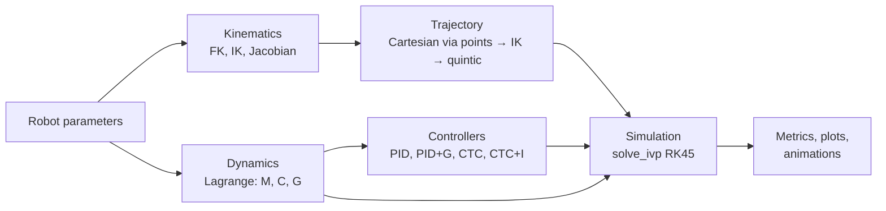

---

## 2. Literature review

| Work | Contribution | Used here for |
|---|---|---|
| Luh, Walker & Paul, 1980 [1] | Recursive Newton–Euler inverse dynamics, the basis of real-time computed-torque control | Inverse-dynamics feed-forward in CTC |
| Takegaki & Arimoto, 1981 [2] | PD control plus gravity compensation is globally asymptotically stable for regulation, using the robot's energy as a Lyapunov function | Motivation for the PID + gravity design |
| Flash & Hogan, 1985 [3] | Human arm motions follow minimum-jerk profiles, which are quintic polynomials | Smooth rest-to-rest quintic trajectories |
| Yoshikawa, 1985 [4] | Manipulability measure w = √det(JJᵀ) quantifies distance to singularity | Singularity monitoring along the path |
| Slotine & Li, 1987 [5] | Adaptive computed torque using the skew-symmetry of Ṁ − 2C and linear parameterisation | Skew-symmetry test; adaptive control as future work |
| Wampler, 1986 / Nakamura & Hanafusa, 1986 [6, 7] | Damped least-squares (singularity-robust) Jacobian inverse | `inverse_velocity` near singularities |
| Kelly, 1998 [8] | Global positioning with PD plus nonlinear integral action | Integral action and anti-windup design |
| Spong, Hutchinson & Vidyasagar [9]; Siciliano *et al.* [10]; Lynch & Park [11] | Standard textbook treatment of manipulator kinematics, dynamics and control | Notation, derivations, controller structure |
| Dormand & Prince, 1980 [12]; SciPy, NumPy, SymPy [13–15] | Embedded RK45 integration; scientific Python | Simulation and symbolic verification |

**Gap addressed.** Textbooks derive CTC under a perfect model. This project quantifies, on the same robot and trajectory, how PID, PID with gravity compensation, CTC and CTC with integral action behave both with an exact model and with a realistic unmodelled payload, and checks the results against the theoretical error-scaling law.

---

## 3. Kinematics

Shorthand: $c_1 = \cos\theta_1$, $s_{12} = \sin(\theta_1+\theta_2)$, etc.

**Forward kinematics**

$$x = l_1c_1 + l_2c_{12},\qquad y = l_1s_1 + l_2s_{12}$$

**Inverse kinematics** (two branches: elbow-up σ = −1, θ₂ < 0; elbow-down σ = +1)

$$c_2 = \frac{x^2 + y^2 - l_1^2 - l_2^2}{2l_1l_2},\quad \theta_2 = \operatorname{atan2}\big(\sigma\sqrt{1 - c_2^2},\ c_2\big),\quad
\theta_1 = \operatorname{atan2}(y, x) - \operatorname{atan2}(l_2s_2,\ l_1 + l_2c_2)$$

**Jacobian and singularities**

$$\mathbf J_v = \begin{bmatrix}-l_1s_1 - l_2s_{12} & -l_2s_{12}\\ l_1c_1 + l_2c_{12} & l_2c_{12}\end{bmatrix},\qquad \det\mathbf J_v = l_1l_2\sin\theta_2$$

The arm is singular when fully stretched or fully folded (θ₂ ∈ {0, π}), i.e. on the outer workspace boundary (r = 1.8 m) and the inner one (r = 0.2 m). The code raises `WorkspaceError` for unreachable targets, warns near singularities, reports manipulability and condition number, and switches to a damped least-squares inverse close to a singularity. Derivation: [THEORY §2–4](docs/THEORY.md#2-forward-kinematics).

---

## 4. Dynamics

Using the Lagrangian $L = T - V$ and the Euler–Lagrange equations:

$$\mathbf M(\boldsymbol\theta)\ddot{\boldsymbol\theta} + \mathbf C(\boldsymbol\theta,\dot{\boldsymbol\theta})\dot{\boldsymbol\theta} + \mathbf G(\boldsymbol\theta) = \boldsymbol\tau$$

$$
\mathbf M = \begin{bmatrix}\alpha + 2\beta c_2 & \delta + \beta c_2\\ \delta + \beta c_2 & \delta\end{bmatrix},\quad
\mathbf C = \begin{bmatrix}h\dot\theta_2 & h(\dot\theta_1 + \dot\theta_2)\\ -h\dot\theta_1 & 0\end{bmatrix},\quad
\mathbf G = \begin{bmatrix}(m_1l_{c1} + m_2l_1)gc_1 + m_2l_{c2}gc_{12}\\ m_2l_{c2}gc_{12}\end{bmatrix}
$$

with $h = -m_2l_1l_{c2}\sin\theta_2$ and, for this robot, $\alpha = 1.304$, $\beta = 0.32$, $\delta = 0.1707$ kg·m².

| Property | Physical meaning | Checked by |
|---|---|---|
| **M** symmetric, positive definite (det M ≥ 0.091) | Kinetic energy is always positive; no dynamic singularities | Test suite |
| Shoulder inertia varies 2.9× across the workspace | A fixed-gain controller sees a different plant in every posture | Discussion |
| **Ṁ − 2C** skew-symmetric | Energy-conserving structure, key to Lyapunov proofs of CTC/adaptive control | Test suite |
| **G** = ∂V/∂θ | Gravity torque is the gradient of potential energy | Test suite |

The Coriolis matrix is built from Christoffel symbols; the full derivation is in [THEORY §5](docs/THEORY.md#5-dynamic-model-lagrangian-mechanics).

---

## 5. Trajectory generation

Each segment is a **quintic polynomial** in joint space with zero velocity and acceleration at the ends, the minimum-jerk profile of Flash & Hogan:

$$\theta(t) = \theta_0 + (\theta_f - \theta_0)\left(10\tau^3 - 15\tau^4 + 6\tau^5\right),\qquad \tau = \frac{t - t_0}{T}$$

Cartesian via points are converted by IK (consistent elbow branch), then linked by piecewise quintics. `check_trajectory_singularities` scans the planned path: the tracking loop used here never comes closer than |sin θ₂| = 0.668.

---

## 6. Controllers

All controllers use the error $\mathbf e = \boldsymbol\theta_d - \boldsymbol\theta$.

| Controller | Control law | Needs a model? |
|---|---|---|
| **PID** | $\boldsymbol\tau = \mathbf K_p\mathbf e + \mathbf K_i\int\mathbf e\,dt + \mathbf K_d\dot{\mathbf e}$ | No |
| **PID + gravity (PID+G)** | PID $+\ \hat{\mathbf G}(\boldsymbol\theta)$ | Gravity only |
| **Computed torque (CTC)** | $\boldsymbol\tau = \hat{\mathbf M}(\ddot{\boldsymbol\theta}_d + \mathbf K_d\dot{\mathbf e} + \mathbf K_p\mathbf e) + \hat{\mathbf C}\dot{\boldsymbol\theta} + \hat{\mathbf G}$ | Full model |
| **CTC + integral (CTC+I)** | Outer loop $\ddot{\boldsymbol\theta}_d + \mathbf K_d\dot{\mathbf e} + \mathbf K_p\mathbf e + \mathbf K_i\int\mathbf e$ | Full model |

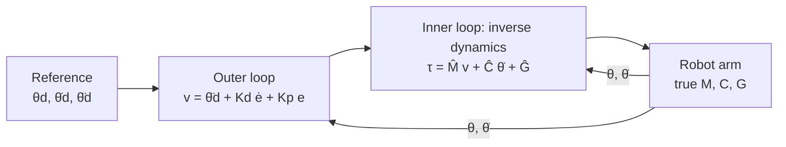

With an exact model, CTC cancels the nonlinear dynamics and leaves **linear, decoupled** error dynamics in every posture:

$$\ddot{\mathbf e} + \mathbf K_d\dot{\mathbf e} + \mathbf K_p\mathbf e = \mathbf 0$$

**Gains**

| Controller | Gains | Design reasoning |
|---|---|---|
| CTC | ωₙ = 10 rad/s, ζ = 1 → Kₚ = 100 s⁻², K_d = 20 s⁻¹ | Critically damped, settling ≈ 0.6 s |
| CTC+I | triple pole at −ωₙ: K_d = 3ωₙ, Kₚ = 3ωₙ², Kᵢ = ωₙ³ | Removes constant model error |
| PID | Kₚ = (200, 100) N·m/rad, Kᵢ = (100, 50), K_d = (30, 10); anti-windup \|∫e\| ≤ 1 rad·s | ≈ 11.5 rad/s joint-1 bandwidth, ζ ≈ 0.87; Routh condition K_dKₚ > mᵢᵢKᵢ holds across the workspace |

---

## 7. Simulation and verification

- **Integrator:** SciPy `solve_ivp`, RK45 (Dormand–Prince), rtol = 10⁻⁸, atol = 10⁻¹⁰, output every 5 ms.
- **Pure controllers:** controllers are functions of (t, state); the PID integrator is part of the ODE state. An integrator updated as a Python attribute would be wrong, because adaptive solvers evaluate trial points they may later reject.
- **Plant vs model:** the simulated robot and the controller's internal model are separate objects, so model mismatch is a one-line change.
- **Reported torques** are recomputed from the stored states, so they are exactly what the plant received.

| Verification | Result |
|---|---|
| SymPy Euler–Lagrange derivation vs hand-derived M, C, G (200 random states) | max difference 4 × 10⁻¹⁵ (round-off) |
| Passive swing, 5 s from θ₀ = (0.3, 0.6) rad at rest | max \|E − E₀\| = 6.0 × 10⁻⁹ J (relative 2.7 × 10⁻¹⁰) |
| Ṁ − 2C skew-symmetric; G = ∂V/∂θ; J and J̇ vs finite differences | pass |
| IK → FK round trip, 1000 random targets, both branches | error < 10⁻¹⁰ m |
| CTC error vs analytic $(1 + \omega_nt)e^{-\omega_nt}$ decay | match to 10⁻⁶ rad |
| **Test suite** | **24/24 pass** |

| 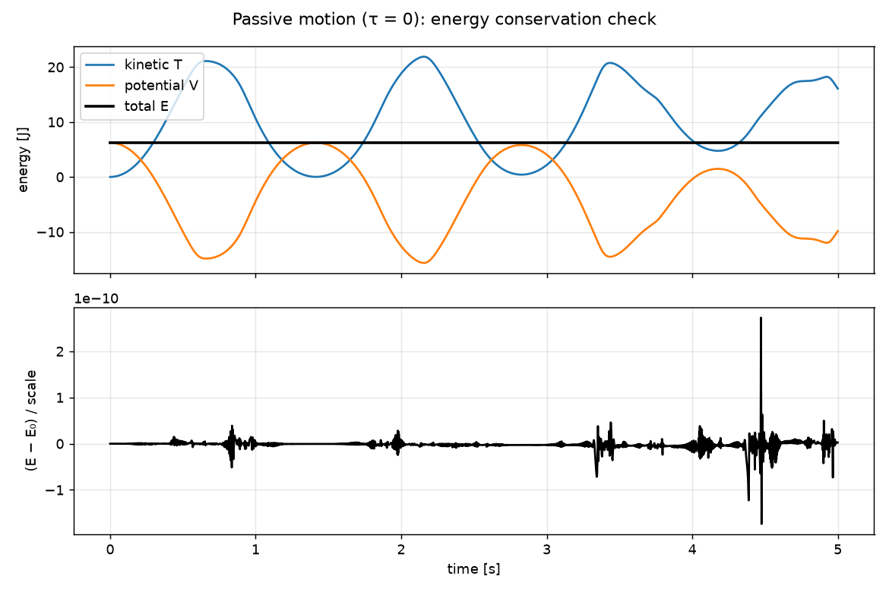 | 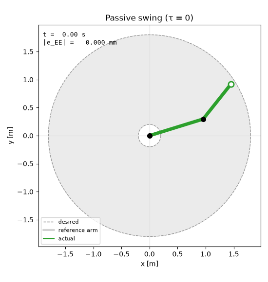 |
|---|---|
| Kinetic, potential and total energy in free swing: total energy stays flat to 10⁻⁹ J | Passive (τ = 0) double-pendulum motion |

---

## 8. Results

### 8.1 Point-to-point motion

(1.5, 0.3) → (−0.6, 1.1) m in 2.5 s, elbow-up. IK gives θ_start = (39.36°, −64.06°) and θ_goal = (158.24°, −92.51°); the elbow-down alternative at the goal is (78.98°, 92.51°). Interpolating in joint space makes the hand follow a curved arc, not a straight line. Under CTC the final position error is about 10⁻¹⁰ mm.

| 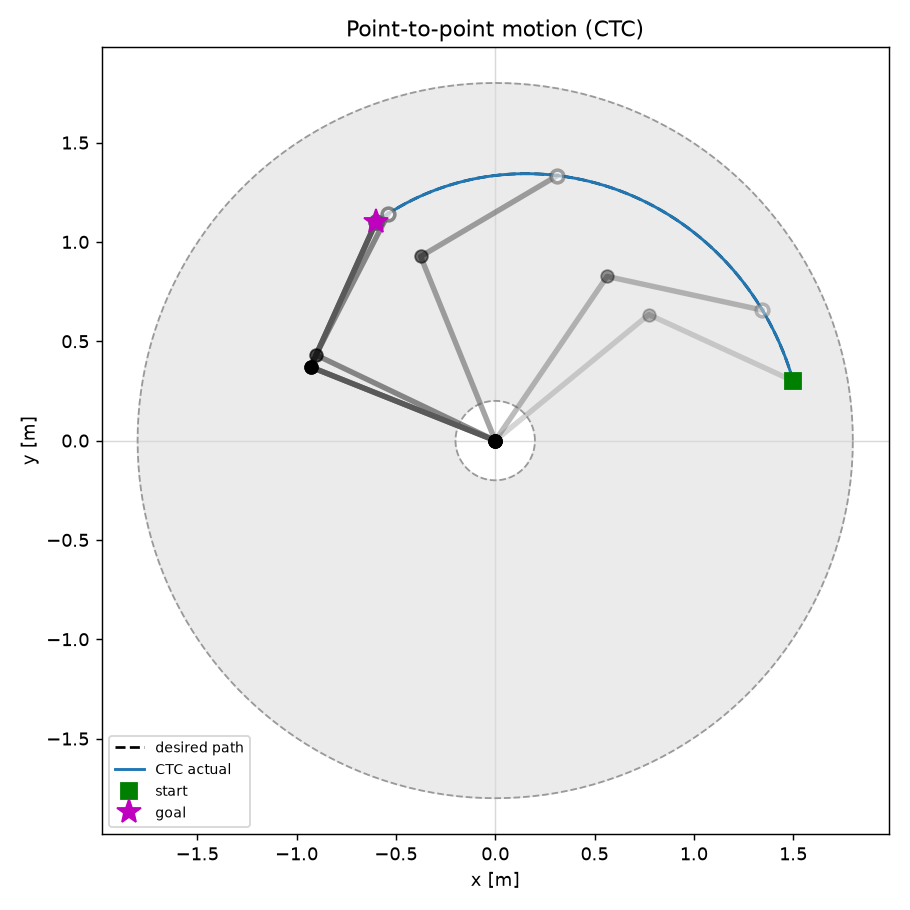 | 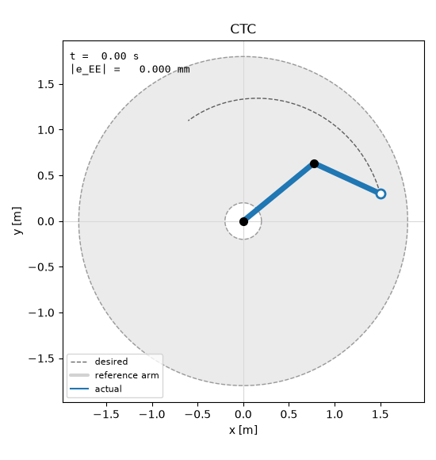 |
|---|---|
| End-effector path and arm snapshots | Animation of the motion |

### 8.2 Trajectory tracking: PID vs PID+G vs CTC

A closed loop through 6 Cartesian via points in 7.5 s, then a 1 s hold; zero initial error.

| Controller | RMSE θ₁ [°] | RMSE θ₂ [°] | Max \|e\| θ₁ [°] | EE RMSE [mm] | EE max [mm] | RMS τ₁ / τ₂ [N·m] | Peak τ₁ [N·m] | Effort ∫τᵀτ dt |
|---|---|---|---|---|---|---|---|---|
| PID | 2.27 | 0.603 | 4.66 | 54.4 | 115 | 9.15 / 2.52 | 15.97 | 766 |
| PID + gravity comp. | 0.263 | 0.083 | 0.828 | 6.24 | 21.1 | 8.83 / 2.58 | 14.86 | 719 |
| **CTC** | **8.4 × 10⁻⁹** | **4.4 × 10⁻⁹** | 5.7 × 10⁻⁸ | **1.6 × 10⁻⁷** | 1.1 × 10⁻⁶ | 8.80 / 2.58 | 14.47 | **715** |

With a **3° initial error** on both joints, CTC's RMSE after the first second is 1.3 × 10⁻⁴°, matching the designed decay; PID's is 2.18° / 0.45°.

| 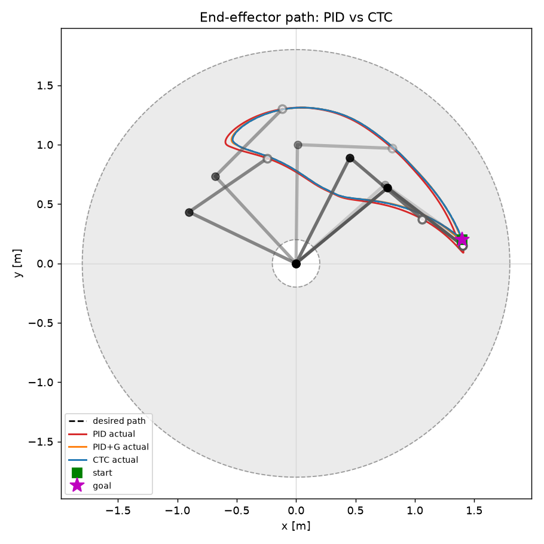 | 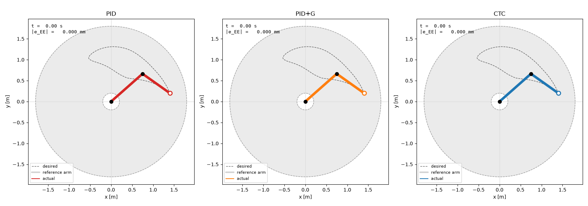 |
|---|---|
| End-effector paths of the three controllers | PID vs CTC side by side |

| 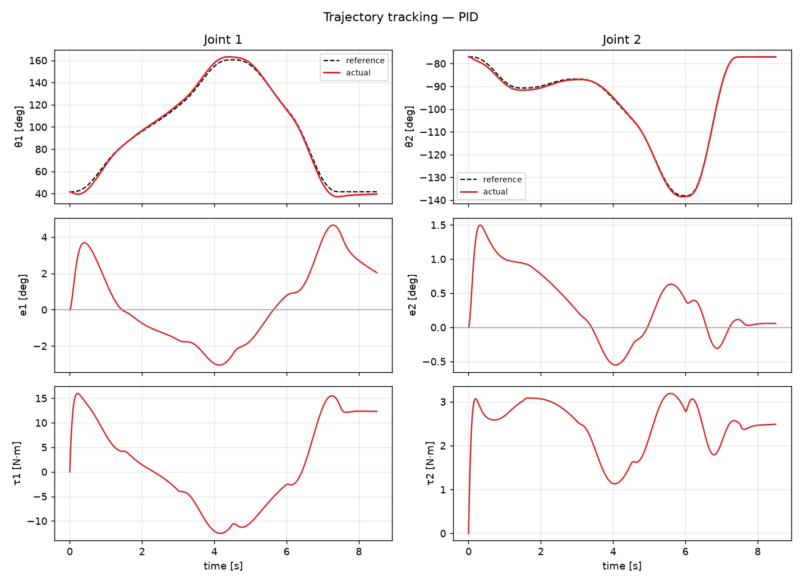 | 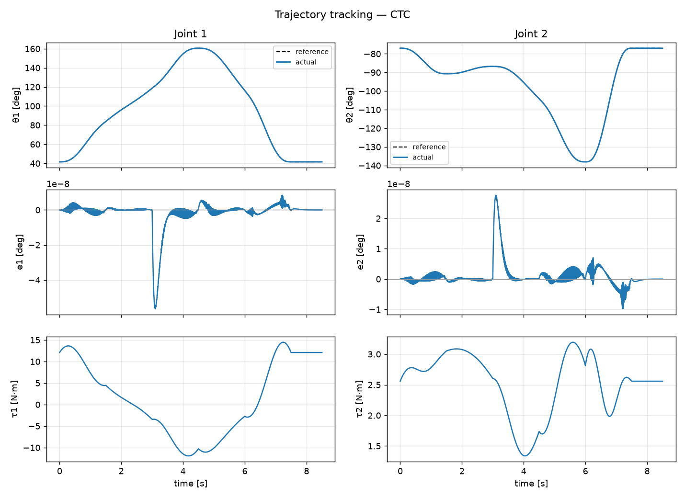 |
|---|---|
| PID: joint angles, errors (degrees) and torques | CTC: errors of order 10⁻⁸ ° |

### 8.3 Robustness: an unmodelled 0.5 kg tip payload

The real arm now carries 0.5 kg at the tip (+62 % distal mass, COM moved outward). Every model-based controller still uses the nominal model.

| Controller | RMSE θ₁ [°] | RMSE θ₂ [°] | Max \|e\| θ₂ [°] | EE RMSE [mm] | EE max [mm] | Effort |
|---|---|---|---|---|---|---|
| PID | 3.32 | 1.39 | 3.67 | 83.0 | 189 | 1851 |
| PID+G (nominal model) | 1.19 | 0.806 | 2.17 | 33.0 | 89.4 | 1761 |
| CTC (nominal model) | 1.65 | **10.3** | **15.0** | **152** | 209 | 1631 |
| **CTC+I (nominal model)** | 0.171 | 0.668 | 2.94 | **10.8** | 48.6 | 1717 |
| CTC (exact model, reference) | 6.2 × 10⁻⁹ | 4.2 × 10⁻⁹ | 2.0 × 10⁻⁸ | 1.2 × 10⁻⁷ | 7.8 × 10⁻⁷ | 1713 |

**Bandwidth sweep** (same payload, EE RMSE):

| ωₙ [rad/s] | CTC (PD outer loop) | CTC+I |
|---|---|---|
| 10 | 152 mm | 10.8 mm |
| 20 | 38.5 mm | 1.74 mm |
| 40 | 9.65 mm | 0.28 mm |

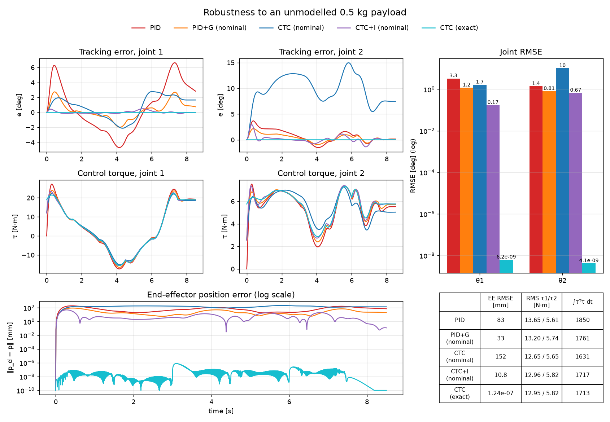

---

## 9. Discussion

**With a correct model, computed torque is in a different league.** CTC cancels M, C and G, so the error obeys a fixed linear equation regardless of posture, even though the shoulder inertia changes 2.9× across the workspace. With zero initial error, tracking stays at integrator precision (~10⁻⁷ mm); with an initial error it decays exactly as designed.

**PID's error is mostly gravity.** Joint 1 carries up to 15.9 N·m of gravity load. With Kₚ = 200 N·m/rad, every change in that load must first appear as an error of order ΔG/Kₚ before the integrator catches up. Adding only the gravity term (PID+G) cuts the error **8.7×** (54.4 → 6.24 mm). The rest is inertial coupling and Coriolis/centrifugal torque, which only full inverse dynamics removes.

**Accuracy does not cost torque.** CTC uses 7 % *less* effort than PID: its torque is essentially the inverse-dynamics feed-forward, so feedback does almost no corrective work. PID's torque lags the required torque, and that lag *is* the error. Neither saturates (peak 16 N·m).

**But a wrong model can make CTC worse than PID.** With the unmodelled payload, CTC's joint-2 error (10.3° RMS) is worse than plain PID's. The model error enters as

$$\boldsymbol\eta = \hat{\mathbf M}^{-1}\big(\tilde{\mathbf M}\ddot{\boldsymbol\theta} + \tilde{\mathbf C}\dot{\boldsymbol\theta} + \tilde{\mathbf G}\big)$$

and the steady error scales as ‖η‖/ωₙ². Two things make it large: the ≈ 3.9 N·m of gravity missing on joint 2 is amplified by $(\hat{\mathbf M}^{-1})_{22}$ (6–21 kg⁻¹m⁻²), and the physical stiffness CTC gives joint 2 is only about $\hat M_{22}\omega_n^2 ≈ 17$ N·m/rad versus PID's 100 N·m/rad. The bandwidth sweep confirms the 1/ωₙ² law (error ÷ ≈ 4 per doubling). **Integral action** removes the constant part of η and cuts the error 14× at the same bandwidth, making CTC+I the best controller that does not know the payload.

**Practical conclusions**

- With a well-identified model, use computed torque: predictable, posture-independent performance at no torque penalty.
- Always give the CTC outer loop integral action (or a robust/adaptive term).
- Without a model, gravity-compensated PID captures most of the benefit for a fraction of the modelling effort.

---

## 10. Applications and impact

| Area | Relevance |
|---|---|
| SCARA and pick-and-place robots | The same two-revolute-joint planar structure; the dynamics and control laws transfer directly |
| Industrial robot programming | Shows why gravity compensation and integral action matter when payloads change between tasks |
| Exoskeletons and rehabilitation robots | Shoulder–elbow models with gravity compensation for human–robot interaction |
| Controller prototyping | The plant/model separation lets you test a control law against mismatch before touching hardware |
| Teaching | A complete, verified reference from equations to animation |

**Impact:** a reproducible benchmark showing, with numbers, when a dynamic model pays off and when it backfires. That is the key decision in deploying model-based control on real robots with uncertain payloads.

---

## 11. Limitations and future work

**Limitations:** simulation only; rigid links; no friction in the default plant (viscous friction is available); continuous-time control with perfect sensing; torque limits optional.

**Future work**

1. **Adaptive computed torque (Slotine–Li).** The dynamics are linear in the parameters, $\mathbf M\ddot{\boldsymbol\theta} + \mathbf C\dot{\boldsymbol\theta} + \mathbf G = \mathbf Y\mathbf p$ with $\mathbf p = (\alpha, \beta, \delta, g_1, g_2)$, so the payload can be learned online. The verified skew-symmetry is the key to the proof.
2. **Robust / sliding-mode outer loop** with a boundary layer for guaranteed accuracy under bounded uncertainty (done in the companion [3R project](https://github.com/mehdihasan261098-bot/3r-robotic-arm-robust-control)).
3. **Actuator limits:** CTC loses its linearisation when saturated; time-scaling or MPC would handle this. A 12 N·m limit is below the static gravity load of the stretched arm, so no controller can hold that path.
4. **Friction and actuator dynamics:** Coulomb/Stribeck friction, motor inertia and gear ratios, with parameter identification.
5. **Discrete-time implementation:** 1 kHz zero-order hold, encoder quantisation and noise.
6. **Task-space control:** operational-space control with straight-line Cartesian paths and manipulability-based singularity avoidance.
7. **Time- or energy-optimal trajectories** under torque limits.

---

## 12. How to run

Requires Python ≥ 3.10.

```bash
python -m venv .venv
```

```bash
.venv\Scripts\activate
```

(Linux/macOS: `source .venv/bin/activate`)

```bash
pip install -r requirements.txt
```

```bash
python -m pytest -q
```

| Command | What it does |
|---|---|
| `python main.py --case passive` | Free swing with τ = 0; energy-conservation check |
| `python main.py --case p2p` | Point-to-point: IK of two Cartesian points, quintic, CTC tracking |
| `python main.py --case pid` / `--case ctc` | Trajectory tracking with one controller |
| `python main.py --case compare --animate` | PID vs CTC: errors, torques, RMSE, side-by-side animation |
| `python main.py --case compare --with-pidg` | Adds PID + gravity compensation |
| `python main.py --case robust --payload 0.5` | Unmodelled payload study |
| `python main.py --case all --no-show --with-pidg --animate` | Everything (~15 s; ~2.5 min with GIFs) |

Options: `--controller pid|pidg|ctc|ctci`, `--elbow down`, `--q0-offset 3 -3` (degrees), `--torque-limit 20` (N·m), `--save-dir DIR`. Print the symbolic equations of motion: `python -m robot2r.symbolic`.

**As a library** (switching controllers is one argument):

```python
from robot2r import RobotArm2R, Simulator, make_controller, joint_trajectory_from_cartesian
from robot2r.visualization import plot_comparison, animate

robot = RobotArm2R()
traj = joint_trajectory_from_cartesian(robot, [(1.4, 0.2), (0.2, 1.3), (-0.5, 1.0)], [0, 2, 4], elbow="up")
results = [Simulator(robot, make_controller(kind, robot), traj).run(t_final=5.0) for kind in ("pid", "ctc")]
plot_comparison(results)
animate(results, save_path="results/my_run.gif")
```

---

## 13. Repository contents

```
2r-robotic-arm-control/
├── README.md
├── docs/THEORY.md            ← full derivations (sections referenced from the code)
├── robot2r/                  ← Python package
│   ├── robot.py              ← RobotParams, RobotArm2R: FK, IK, Jacobian, singularities, M/C/G, energy
│   ├── trajectory.py         ← quintic and piecewise-quintic trajectories, Cartesian → joint, singularity scan
│   ├── controllers.py        ← PID (+ gravity), computed torque (+ integral), make_controller()
│   ├── simulation.py         ← Simulator (solve_ivp), SimulationResult, metrics
│   ├── visualization.py      ← tracking, task-space, energy and comparison plots, animation
│   └── symbolic.py           ← SymPy Lagrangian derivation and cross-check
├── tests/test_robot2r.py     ← 24 verification tests
├── main.py                   ← command-line entry point for all cases
├── results/                  ← figures, GIF animations and metrics.md
└── requirements.txt
```

## 14. References

1. J. Y. S. Luh, M. W. Walker and R. P. C. Paul, "On-line computational scheme for mechanical manipulators," *J. Dyn. Syst. Meas. Control*, vol. 102, pp. 69–76, 1980. doi:[10.1115/1.3149599](https://doi.org/10.1115/1.3149599)
2. M. Takegaki and S. Arimoto, "A new feedback method for dynamic control of manipulators," *J. Dyn. Syst. Meas. Control*, vol. 103, pp. 119–125, 1981. doi:[10.1115/1.3139651](https://doi.org/10.1115/1.3139651)
3. T. Flash and N. Hogan, "The coordination of arm movements: an experimentally confirmed mathematical model," *J. Neurosci.*, vol. 5, pp. 1688–1703, 1985. doi:[10.1523/JNEUROSCI.05-07-01688.1985](https://doi.org/10.1523/JNEUROSCI.05-07-01688.1985)
4. T. Yoshikawa, "Manipulability of robotic mechanisms," *Int. J. Robot. Res.*, vol. 4, pp. 3–9, 1985. doi:[10.1177/027836498500400201](https://doi.org/10.1177/027836498500400201)
5. J.-J. E. Slotine and W. Li, "On the adaptive control of robot manipulators," *Int. J. Robot. Res.*, vol. 6, pp. 49–59, 1987. doi:[10.1177/027836498700600303](https://doi.org/10.1177/027836498700600303)
6. C. W. Wampler, "Manipulator inverse kinematic solutions based on vector formulations and damped least-squares methods," *IEEE Trans. Syst. Man Cybern.*, vol. 16, pp. 93–101, 1986. doi:[10.1109/TSMC.1986.289285](https://doi.org/10.1109/TSMC.1986.289285)
7. Y. Nakamura and H. Hanafusa, "Inverse kinematic solutions with singularity robustness for robot manipulator control," *J. Dyn. Syst. Meas. Control*, vol. 108, pp. 163–171, 1986. doi:[10.1115/1.3143764](https://doi.org/10.1115/1.3143764)
8. R. Kelly, "Global positioning of robot manipulators via PD control plus a class of nonlinear integral actions," *IEEE Trans. Autom. Control*, vol. 43, pp. 934–938, 1998. doi:[10.1109/9.701091](https://doi.org/10.1109/9.701091)
9. M. W. Spong, S. Hutchinson and M. Vidyasagar, *Robot Modeling and Control*, 2nd ed. Wiley, 2020.
10. B. Siciliano, L. Sciavicco, L. Villani and G. Oriolo, *Robotics: Modelling, Planning and Control*. Springer, 2009. doi:[10.1007/978-1-84628-642-1](https://doi.org/10.1007/978-1-84628-642-1)
11. K. M. Lynch and F. C. Park, *Modern Robotics: Mechanics, Planning, and Control*. Cambridge University Press, 2017. doi:[10.1017/9781316661239](https://doi.org/10.1017/9781316661239)
12. J. R. Dormand and P. J. Prince, "A family of embedded Runge–Kutta formulae," *J. Comput. Appl. Math.*, vol. 6, pp. 19–26, 1980. doi:[10.1016/0771-050X(80)90013-3](https://doi.org/10.1016/0771-050X(80)90013-3)
13. P. Virtanen *et al.*, "SciPy 1.0: fundamental algorithms for scientific computing in Python," *Nat. Methods*, vol. 17, pp. 261–272, 2020. doi:[10.1038/s41592-019-0686-2](https://doi.org/10.1038/s41592-019-0686-2)
14. C. R. Harris *et al.*, "Array programming with NumPy," *Nature*, vol. 585, pp. 357–362, 2020. doi:[10.1038/s41586-020-2649-2](https://doi.org/10.1038/s41586-020-2649-2)
15. A. Meurer *et al.*, "SymPy: symbolic computing in Python," *PeerJ Comput. Sci.*, vol. 3, e103, 2017. doi:[10.7717/peerj-cs.103](https://doi.org/10.7717/peerj-cs.103)

---

<sub>© 2026 Mehdi Hasan · [Portfolio](https://mehdi-hasan.netlify.app) · [LinkedIn](https://www.linkedin.com/in/mehdi-hasan-868639245) · [GitHub](https://github.com/mehdihasan261098-bot)</sub>
